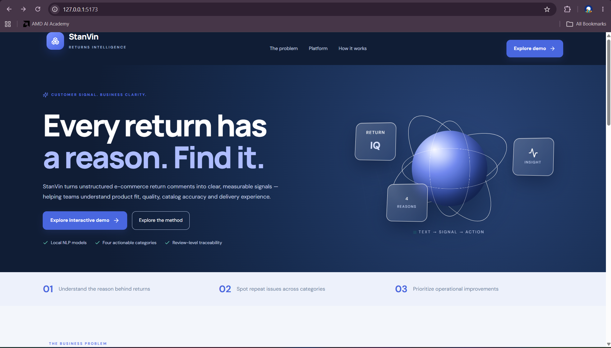
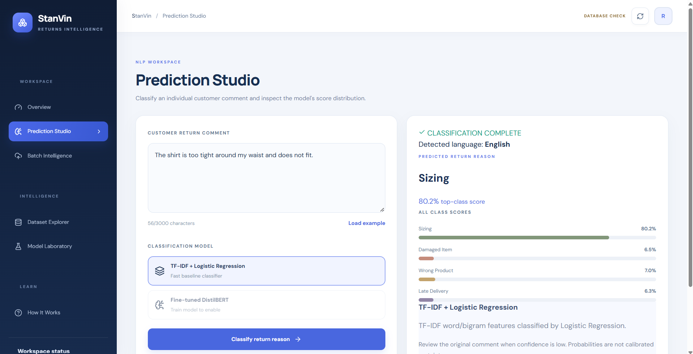
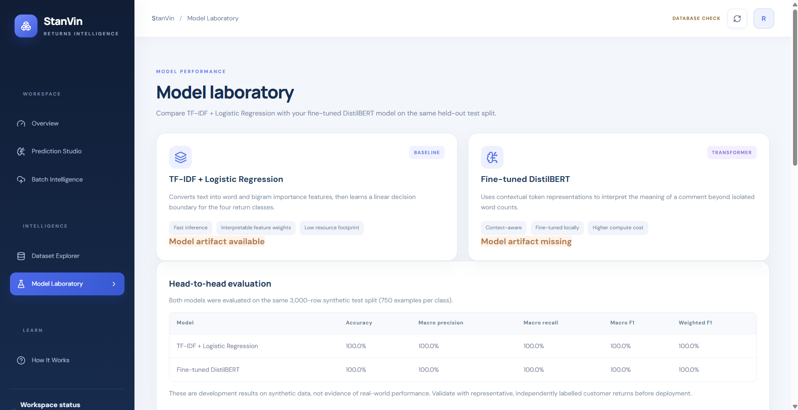
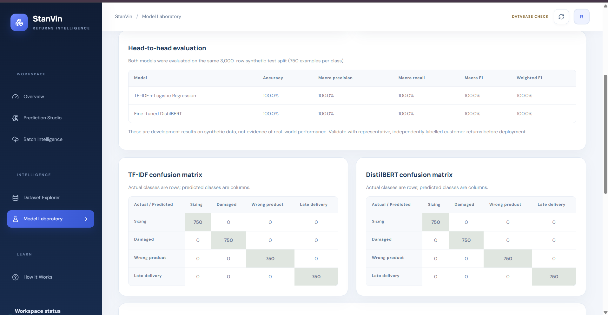
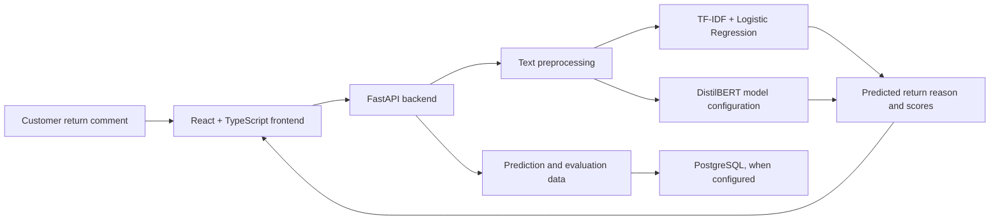

# StanVin — Returns Intelligence

**StanVin** is an NLP-powered returns intelligence platform that turns unstructured e-commerce return comments into structured signals. It helps teams understand why customers return products and identify recurring issues across sizing, product quality, catalog accuracy, and delivery experience.

> The screenshots below show the current StanVin interface.

## Product Screenshots

### 1. Landing Page



### 2. Prediction Studio

Classify an individual customer return comment, view the predicted return reason, and inspect the model's class-score distribution.



### 3. Model Laboratory

Compare the TF-IDF + Logistic Regression baseline with the fine-tuned DistilBERT model configuration.



### 4. Model Evaluation

The evaluation view includes model comparison and confusion matrices for the four return categories.



## Key Features

- **Return-reason classification:** classify customer comments into four categories:
  - Sizing
  - Damaged Item
  - Wrong Product
  - Late Delivery
- **Prediction Studio:** submit a single comment and review the predicted class and class scores.
- **Batch Intelligence:** process multiple return comments in a batch.
- **Dataset Explorer:** inspect the dataset used by the application.
- **Model Laboratory:** review the baseline and transformer model configurations.
- **Evaluation views:** compare model metrics and inspect confusion matrices.
- **Review-level traceability:** retain the original customer comment alongside its predicted category.
- **API-backed application:** React frontend communicates with a FastAPI backend.

## Technology Stack

| Layer | Technologies |
|---|---|
| Frontend | React, TypeScript, Vite |
| Backend | Python, FastAPI |
| NLP baseline | TF-IDF, Logistic Regression |
| Transformer model | DistilBERT configuration |
| Data and evaluation | Python machine-learning and data-processing libraries |
| Database | PostgreSQL integration (when configured) |

## Return Categories

| Category | What it represents |
|---|---|
| Sizing | The product does not fit as expected |
| Damaged Item | The product arrived damaged or defective |
| Wrong Product | The received item differs from the ordered item |
| Late Delivery | The order arrived later than expected |

## Application Architecture



## Run Locally

### Prerequisites

- Python installed
- Node.js and npm installed
- Git installed

### 1. Clone the repository

```powershell
git clone https://github.com/Bodigestanley/StanVin_NLP.git
cd StanVin_NLP
```

### 2. Start the backend

From the project root, use the backend startup script included in the repository:

```powershell
.\start_backend.ps1
```

Keep this terminal running. If your local project uses a different backend startup command, follow the backend instructions and dependency file included in the repository.

### 3. Start the frontend

Open a second terminal:

```powershell
cd frontend
npm install
npm run dev
```

Open the local URL printed by Vite in your browser (commonly `http://localhost:5173`).

## API Endpoints Used by the Frontend

The frontend is configured to communicate with these backend routes:

| Endpoint | Purpose |
|---|---|
| `GET /api/health` | Backend health check |
| `GET /api/predictions/recent?limit=500` | Retrieve recent predictions |
| `GET /api/evaluation/latest` | Retrieve the latest evaluation |
| `POST /api/predict` | Classify one return comment |
| `POST /api/predict/batch` | Classify a batch of return comments |

## Model and Evaluation Notes

- The baseline classifier shown in the interface is **TF-IDF + Logistic Regression**.
- The interface also presents a **fine-tuned DistilBERT** model comparison. The screenshot supplied for this README shows the DistilBERT model artifact as missing in that local run; it should not be described as available for inference until its artifact has been trained or supplied.
- The evaluation screenshot reports 100% metrics on a 3,000-row synthetic test split (750 examples per class). These are development results on synthetic data, not evidence of real-world performance.
- Validate the model using representative, independently labelled customer-return data before using it for business decisions.
- Model confidence/probability scores should not be treated as calibrated probabilities unless calibration has been independently evaluated.
- PostgreSQL is optional for local operation only if the application configuration supports running without it. Configure the database credentials and service before relying on database-backed features.

## Project Structure

```text
StanVin_NLP/
├── frontend/              # React + TypeScript + Vite application
├── backend/               # FastAPI backend and API logic
├── docs/
│   └── images/            # Current StanVin UI screenshots
├── start_backend.ps1      # Backend startup script
└── README.md
```

*The exact contents of the repository may include additional training scripts, datasets, model artifacts, and configuration files.*

## Future Improvements

- Evaluate with larger, real-world, independently labelled return datasets.
- Improve class balance and monitor model performance over time.
- Train and package the DistilBERT model artifact for inference.
- Add model and data versioning.
- Strengthen deployment, monitoring, and database configuration.

## Author

**StanVin**

---

If you find an issue or have a suggestion, please open an issue in this repository.
