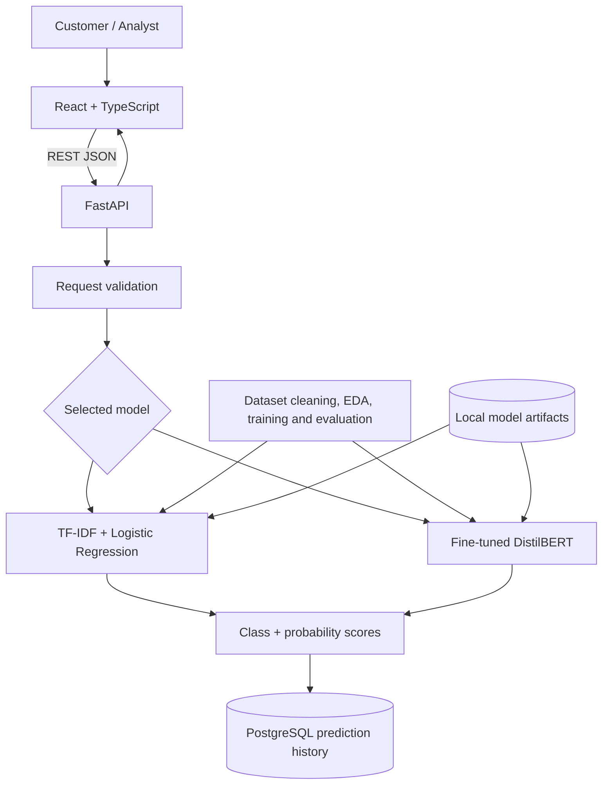

# ReturnIQ architecture

## NLP path

1. **Input:** a natural-language return comment.
2. **Validation:** enforce minimum/maximum length and model selection.
3. **Baseline preprocessing:** lowercase, URL removal, punctuation cleanup and whitespace normalization.
4. **TF-IDF:** unigram/bigram term-frequency features reweighted by inverse document frequency.
5. **Logistic Regression:** multiclass classifier produces class probabilities.
6. **Transformer path:** DistilBERT tokenizer creates token IDs and attention masks; fine-tuned classification head produces four class scores.
7. **Evaluation:** use separate training, validation and test sets for DistilBERT; report accuracy, macro/weighted F1, per-class precision/recall and confusion matrix.
8. **Persistence:** API stores prediction text, predicted class, confidence, model name and timestamp in PostgreSQL.

## Storage decisions

PostgreSQL stores structured application records and prediction history. CSV datasets and trained model weights remain in the local project filesystem; large binary model artifacts are not stored in relational tables.
